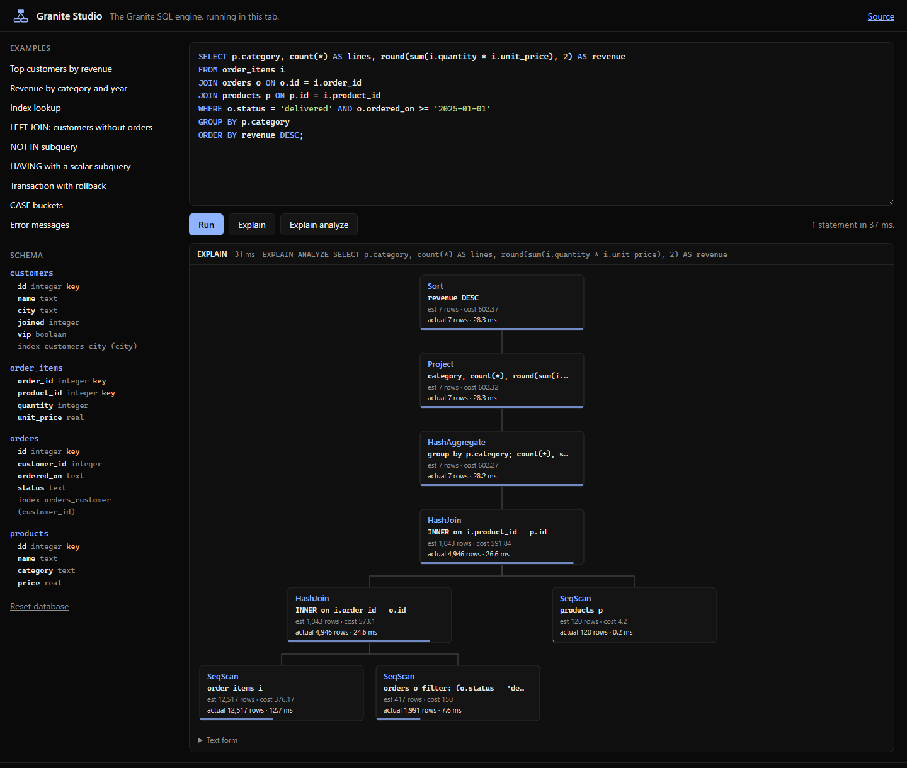

<p></p>

# Granite

Granite is a relational database engine in TypeScript, built from the SQL parser down to the pages on disk: a cost-based planner, B+tree tables and indexes, a write-ahead log with crash recovery, and MVCC snapshot isolation. It has no runtime dependencies.

[](https://github.com/TIENDUNG21/granite-sql-engine/actions/workflows/ci.yml)
[](LICENSE)

```text
granite> .sample
Created customers (1000), products (120), orders (5000) and order_items.
granite> SELECT c.city, count(DISTINCT o.customer_id) AS buyers,
    ...>        round(sum(i.quantity * i.unit_price), 2) AS revenue
    ...> FROM orders o
    ...> JOIN customers c ON c.id = o.customer_id
    ...> JOIN order_items i ON i.order_id = o.id
    ...> WHERE o.status = 'delivered'
    ...> GROUP BY c.city
    ...> ORDER BY revenue DESC
    ...> LIMIT 4;
 city        | buyers | revenue
-------------+--------+-----------
 Hồ Chí Minh |    295 | 174477.67
 Hà Nội      |    219 | 133056.33
 Đà Nẵng     |     93 |  62674.16
 Hải Phòng   |     68 |  32674.56
(4 rows)
granite> EXPLAIN ANALYZE SELECT o.id, o.ordered_on
    ...> FROM orders o JOIN customers c ON c.id = o.customer_id
    ...> WHERE c.city = 'Huế' AND o.status = 'pending';
Project o.id, o.ordered_on  (rows=125 cost=179.25 actual=10 time=6.42ms)
└─ HashJoin INNER on o.customer_id = c.id  (rows=125 cost=178.63 actual=10 time=6.412ms)
   ├─ SeqScan orders o filter: o.status = 'pending'  (rows=1250 cost=150 actual=261 time=5.734ms)
   └─ IndexScan customers c using customers_city (city = 'Huế')  (rows=100 cost=23 actual=46 time=0.51ms)
granite> SELECT name, citty FROM customers WHERE vip;
error[undefined_column]: column "citty" does not exist
 --> line 1, column 14
  |
1 | SELECT name, citty FROM customers WHERE vip;
  |              ^^^^^
  = hint: did you mean "city"?
```

The transcript is a real run; after `npm run build`, `node scripts/transcript.ts scripts/readme-session.txt` reproduces it. The same engine runs in the browser as **[Granite Studio](https://tiendung21.github.io/granite-sql-engine/)**, on an in-memory file system with the sample shop loaded.

## SQL

- `CREATE TABLE` with `PRIMARY KEY` (single or composite), `NOT NULL`, `UNIQUE`, `DEFAULT`; `CREATE [UNIQUE] INDEX`; `DROP TABLE`, `DROP INDEX`; `IF [NOT] EXISTS` on all four.
- `INSERT ... VALUES` and `INSERT ... SELECT`, `UPDATE`, `DELETE`, parameters `$1, $2, ...`.
- `SELECT [DISTINCT]` with `INNER`, `LEFT` and `CROSS` joins, `WHERE`, `GROUP BY`, `HAVING`, `ORDER BY ... [NULLS FIRST|LAST]`, `LIMIT`/`OFFSET`, uncorrelated `IN (SELECT ...)` and scalar subqueries.
- Expressions: `CASE`, `CAST`, `BETWEEN`, `LIKE`, `IN (...)`, `IS [NOT] NULL`, `||`, arithmetic with overflow and division-by-zero errors, three-valued logic. Aggregates `count`, `sum`, `avg`, `min`, `max` (with `DISTINCT`); functions `abs`, `round`, `length`, `upper`, `lower`, `substr`, `trim`, `replace`, `coalesce`, `nullif`.
- `BEGIN`, `COMMIT`, `ROLLBACK`, `EXPLAIN [ANALYZE]`, `ANALYZE`, `VACUUM`, `CHECKPOINT`.
- Types `INTEGER` (exact up to 2^53), `REAL`, `TEXT`, `BOOLEAN`. Text is normalized to NFC on input and compared by code point, so index order matches `ORDER BY` and `length('Việt')` is 4 however it was typed.

Unsupported syntax fails with `feature_not_supported` at its position instead of being misread: `RIGHT JOIN`, `UNION`, `EXISTS` and correlated subqueries, for example.

## How it works

A statement travels through the layers a textbook database has, each in its own module of `packages/core/src`.

**Front end.** A hand-written lexer and recursive-descent parser (Pratt parsing for expressions) produce an AST with source spans. The binder resolves names against the catalog, expands `*`, checks types and aggregate placement, and turns names into column ids. Every error carries a span, so the shell and Studio can point at the token.

**Planner.** The bound query becomes a logical plan. The optimizer folds constants (leaving `1/0` for run time, so `WHERE false AND 1/0 = 1` stays legal), pushes predicates down to scans and join inputs without crossing the nullable side of a `LEFT JOIN`, picks between a sequential scan and each usable index (equality on a prefix, `IN` lists, ranges), and orders joins by dynamic programming over left-deep trees, as in System R (Selinger et al., 1979), switching to a greedy order above ten relations. Costs come from `ANALYZE` statistics: row count, distinct values, null fraction, min and max. Without histograms, skewed columns are estimated poorly; `EXPLAIN ANALYZE` shows estimates next to actual rows so this is visible.

**Executor.** Physical plans run as Volcano iterators (Graefe, 1994): `SeqScan`, `IndexScan`, `Filter`, `Project`, `NestedLoopJoin`, `HashJoin`, `HashAggregate`, `Sort`, `Distinct`, `Limit`. Uncorrelated subqueries run once per statement, on first use.

**Storage.** The database is one file of 4 KiB pages behind a pager with a buffer cache. Tables are B+trees keyed by an internal row id. Secondary indexes are B+trees whose keys are the indexed values followed by the row id, encoded so that comparing the bytes compares the values, with NULLs first. Pages are slotted. Large values continue in overflow chains, and freed pages go to a free list. File access goes through a small synchronous interface with two implementations: Node's `fs` and an in-memory one that can simulate power loss. Studio and the crash tests both use the in-memory one.

**Durability.** A commit appends full images of every changed page and a commit record to a write-ahead log, each record with a CRC-32 seeded by a per-checkpoint epoch, and then fsyncs. Only checkpoints write the data file. Recovery replays complete commit groups and ignores everything after the first torn or damaged record. Full page images cost write volume but make replay idempotent and repair torn writes in the data file, so there is no undo log. Inside `BEGIN ... COMMIT`, changed pages stay in the cache and are logged once, at the next commit.

**Transactions.** MVCC follows PostgreSQL. Each row version carries the id of the transaction that created it (`xmin`) and the one that deleted it (`xmax`). A commit log stores two bits per transaction id. A snapshot is the next transaction id plus the set of running ones. `UPDATE` marks the old version and inserts a new one with fresh index entries, so readers never block. The engine is single-threaded and cannot wait for a lock, so the second writer of a row fails with `serialization_failure` (first updater wins). The same happens for a key that another open transaction inserted. Transactions left open by a crash are marked aborted when the database opens, and `VACUUM` removes versions that no snapshot can see.

`docs/ARCHITECTURE.md` follows one query through every layer and describes the file formats. `docs/adr/` records the main design decisions.

## Embedding

The CLI and Studio are thin layers over the library, `@granite/core` in this repository (it is not published to npm):

```ts
import { Database, formatError } from '@granite/core';

const db = Database.open(); // or { fs: new NodeFileSystem(), path: 'shop.db' } from '@granite/core/node'
db.execute('CREATE TABLE stock (sku TEXT PRIMARY KEY, qty INTEGER NOT NULL)');
db.execute("INSERT INTO stock VALUES ('phin-filter', 3)");

const a = db.session();
const b = db.session();
a.execute('BEGIN');
b.execute('BEGIN');
a.execute("UPDATE stock SET qty = qty - 1 WHERE sku = 'phin-filter'");
console.log(b.executeOne("SELECT qty FROM stock WHERE sku = 'phin-filter'").rows);
try {
  b.execute("UPDATE stock SET qty = qty - 1 WHERE sku = 'phin-filter'");
} catch (err) {
  console.log(formatError(err));
}
a.execute('COMMIT');
b.execute('ROLLBACK');
console.log(db.query('SELECT qty FROM stock').rows);
```

```text
[ [ 3 ] ]
error[serialization_failure]: could not serialize access due to a concurrent update
 --> line 1, column 1
  |
1 | UPDATE stock SET qty = qty - 1 WHERE sku = 'phin-filter'
  | ^^^^^^^^^^^^^^^^^^^^^^^^^^^^^^^^^^^^^^^^^^^^^^^^^^^^^^^^
  = hint: roll back and retry the transaction
[ [ 2 ] ]
```

## Granite Studio

[Granite Studio](https://tiendung21.github.io/granite-sql-engine/) is a Vite app with no framework. Syntax highlighting comes from the engine's own lexer in a lenient mode, so the colors always match what the parser will accept. Each statement gets its own result card, and errors keep the editor's line and column numbers. The plan view draws `EXPLAIN` output as an SVG tree, with measured rows, times and a bar for each node's share of the time after `EXPLAIN ANALYZE`. A link can carry a query: `#sql=<url-encoded SQL>&plan=analyze`.



## Performance

From `npm run bench` on an Intel Core i7-14700K (28 threads), 32 GB RAM, Windows 11, Node 22.19. The data is a table of 100,000 rows with a secondary index, plus a 1,000-row table to join with. Every query is parsed, bound and planned again, because there are no prepared statements. Other processes shared the CPU during the run.

| Operation | Result |
| --- | ---: |
| Bulk insert, one transaction, on disk | 86,475 rows/s |
| Autocommit insert, fsync per commit | 3,800 commits/s |
| Point lookup by primary key, parse to result | 12.3 µs |
| Range scan on a secondary index, ~1,000 rows | 2.06 ms |
| Full scan with a filter, 100,000 rows | 88.1 ms |
| Hash join and aggregate, 100,000 x 1,000 rows | 118.6 ms |
| `UPDATE` of 10,170 rows (new versions and index entries) | 219.5 ms |
| Crash recovery, 4.2 MiB of log | 15.0 ms |

All twelve measurements and the method are in [docs/BENCHMARKS.md](docs/BENCHMARKS.md). The benchmark helped find two problems before release: a cache eviction bug that lost a page written by a large `UPDATE`, and range estimates that multiplied two bounds as if they were independent.

## Limitations

- One process, one thread. Sessions take turns statement by statement and nothing ever waits: write conflicts fail at once and the client retries.
- Snapshot isolation is not serializable. Write skew is possible, as in PostgreSQL's `REPEATABLE READ`.
- DDL is not transactional. It is refused inside `BEGIN` and while other transactions are open.
- No `RIGHT`/`FULL` joins, set operations, `EXISTS`, correlated subqueries, CTEs, window functions, views, `ALTER TABLE`, foreign keys or `CHECK` constraints.
- No prepared statements or plan cache.
- B+tree deletes never merge pages. `VACUUM` removes dead versions but does not shrink the file.
- Statistics have no histograms, and `TEXT` ranges use a fixed selectivity.
- Sorts and hash tables live in memory, with no spilling to disk. An open transaction keeps its changed pages in memory until it commits.
- The commit log covers 16.5 million write transactions over the life of a database, with no id wraparound.
- Studio keeps its database in memory only; reloading the page resets it.

## Roadmap

These were left out of 1.0 on purpose, in rough order of value: saving Studio databases to IndexedDB (export and import of the in-memory files), histograms in `ANALYZE`, prepared statements with a plan cache, merging underfull B+tree nodes, sorts and hash joins that spill to disk, correlated subqueries and `EXISTS`, and serializable snapshot isolation.

## Building from source

Requires Node 22.18 or newer, which runs TypeScript files directly for the scripts.

```sh
npm ci
npm run build        # core and CLI to dist/, Studio to apps/studio/dist
npm test             # Vitest: unit, property, sqllogictest, crash and isolation tests
npm run bench        # add -- --markdown docs/BENCHMARKS.md to rewrite the results
node packages/cli/dist/bin.js shop.db
```

The shell accepts `-c SQL` (repeatable; exit status 1 on error), `-m table|csv|json|line` and `--sample`, and reads piped SQL from standard input. Interactive commands: `.tables`, `.schema`, `.indexes`, `.explain`, `.mode`, `.timer`, `.read`, `.sample`, `.help`, `.quit`. Studio's dev server is `npm run dev --workspace apps/studio`.

## Tests

254 Vitest tests in 23 files. Among them:

- 305 sqllogictest-style records in `tests/sql/*.test` (the format of SQLite's sqllogictest), covering NULL logic, types, text, joins, aggregates, subqueries, errors and two-connection isolation: dirty reads, repeatable reads, lost updates and rollback.
- Property tests with fast-check: the B+tree against a `Map` model, key encoding order against value order, parser print/parse round trips and fuzzing, random interleavings of two sessions against a serial count, and the plan layout.
- Crash tests that stop the engine at each of the 134 file operations (writes, truncates, fsyncs) of a workload. They then leave on disk what a power cut could: a random prefix of the unsynced log tail, sometimes followed by garbage, and each 512-byte sector of the data file either old or new. The database must reopen with exactly a committed prefix and keep working. Property tests cut the log at random byte offsets and append garbage, another flips a byte,, and require recovery to keep exactly the complete groups before the damage.
- Differential tests that run queries with and without indexes and statistics, and snapshot tests of the plans on the sample dataset.

## References

- G. Graefe. Volcano: An Extensible and Parallel Query Evaluation System. IEEE TKDE 6(1), 1994.
- P. G. Selinger, M. M. Astrahan, D. D. Chamberlin, R. A. Lorie, T. G. Price. Access Path Selection in a Relational Database Management System. SIGMOD 1979.
- D. Comer. The Ubiquitous B-Tree. ACM Computing Surveys 11(2), 1979.
- H. Berenson, P. Bernstein, J. Gray, J. Melton, E. O'Neil, P. O'Neil. A Critique of ANSI SQL Isolation Levels. SIGMOD 1995.
- C. Mohan, D. Haderle, B. Lindsay, H. Pirahesh, P. Schwarz. ARIES: A Transaction Recovery Method Supporting Fine-Granularity Locking and Partial Rollbacks Using Write-Ahead Logging. ACM TODS 17(1), 1992.
- J. M. Hellerstein, M. Stonebraker, J. Hamilton. Architecture of a Database System. Foundations and Trends in Databases 1(2), 2007.
- PostgreSQL documentation, chapter "Concurrency Control", and the source of `clauselist_selectivity`.
- Unicode Standard Annex #15, Unicode Normalization Forms.

## License

MIT. The sample dataset is synthetic: it is generated from a fixed seed by `packages/core/src/sample/dataset.ts` and describes no real people or sales.
