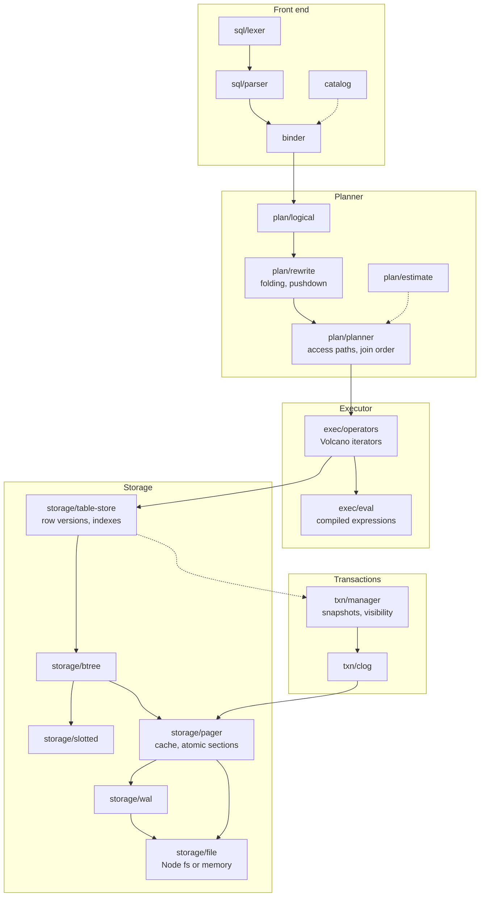

# Architecture

Granite is split into three packages. `packages/core` is the database: everything from SQL text to bytes in a file, with no runtime dependencies. `packages/cli` is the interactive shell and `apps/studio` the browser front end, and both only call the public API of the core (`Database`, `Session`, `QueryResult`, `formatError`).



| Module | Lines (non-blank, with comments) | Responsibility |
| --- | ---: | --- |
| `sql` | 1,337 | Tokens with spans, recursive-descent parser, AST |
| `binder`, `catalog` | 1,793 | Name resolution, types, functions, schema |
| `plan` | 1,187 | Logical plans, rewrites, statistics, costing, join order |
| `exec` | 1,022 | Operators and expression evaluation |
| `storage` | 1,727 | Files, pager, WAL, slotted pages, B+tree, codecs, tables |
| `txn` | 224 | Commit log, snapshots, visibility, conflicts |
| `engine` | 620 | `Database`, `Session`, statement execution |

## Following a query

Take this query from the Studio examples:

```sql
SELECT id, ordered_on, status FROM orders WHERE customer_id = 42 ORDER BY ordered_on;
```

**Lexing and parsing.** `tokenize` produces words, numbers, strings, symbols and parameters, each with its start and end offset. String literals are normalized to NFC here, so `'Việt'` typed with combining marks is the same value as the precomposed form. The parser is recursive descent for statements and Pratt parsing for expressions (precedence `OR < AND < NOT < comparisons < || < + - < * / % < unary`). Every AST node keeps its span. Error positions come from these spans, and `formatError` turns them into the caret excerpt. Columns are counted in code points so the caret lines up under non-ASCII text.

**Binding.** The binder looks `orders` up in the catalog (unquoted names are case-insensitive), resolves `customer_id` to a column id, checks that `customer_id = 42` compares compatible types, and records the output columns and their types. Errors such as an unknown column with a near miss (`did you mean "city"?`), aggregates in `WHERE` or a non-grouped column in the select list are raised here, with the span of the offending expression.

**Logical plan and rewrites.** The bound query becomes `Sort(Project(Filter(Scan orders)))`. The rewriter folds constant subexpressions (a failing one like `1/0` is left in place, so the error only happens if a row needs it), splits `WHERE` into conjuncts and pushes each one to the lowest scan or join input that has all its columns. A conjunct is never pushed into the nullable side of a `LEFT JOIN`.

**Physical planning.** For each scan the planner compares a sequential scan with every index whose leading columns are constrained by an equality, an `IN` list or a range. The cost model counts page reads and rows: a sequential scan pays for all pages, an index scan pays per probe and per matching row. Selectivity comes from `ANALYZE`: distinct counts for equality, min/max interpolation for ranges (bounds on the same column combine into one interval), null fractions. Here the planner chooses `IndexScan orders using orders_customer (customer_id = 42)`. With several tables, joins are ordered by dynamic programming over left-deep trees, choosing a hash join for equi-joins (the build side is the smaller input) and a nested loop otherwise.

**Execution.** Operators implement `open`/`next`/`close` and pull rows from their children. Expressions are compiled once into closures over row positions. The index scan walks the B+tree of `orders_customer` from the first key that starts with the encoded value 42. For each entry it takes the row id from the key suffix, fetches the row from the table's B+tree, checks the version's visibility against the session's snapshot and yields the decoded values. `Sort` buffers its input and sorts it with `compareValues`, the order that the index key encoding preserves.

## Storage

The database file is an array of 4 KiB pages. Page 0 is the header:

| Offset | Field |
| ---: | --- |
| 0 | magic `GRANITE\0` |
| 8 | format version (u16), page size (u16) |
| 12 | page count |
| 16 | first free page, free page count |
| 24 | next transaction id |
| 28 | number of commit-log pages |
| 64 | page numbers of the commit-log pages (u32 each) |

Page 1 is the root of the catalog B+tree, which maps table names to their JSON schema, including index definitions, root pages and `ANALYZE` statistics.

**Pager.** All page access goes through the pager. It caches pages and tracks the dirty ones. While a statement runs, the first write to each page saves the page's previous bytes, so a failed statement can be undone by putting them back (an *atomic section*). Statements run synchronously one at a time, so these pre-images are exact. The cache is trimmed between statements, never during one, because operators hold on to pages they have read. Pages are evicted least recently used first, and pages that are dirty or not yet checkpointed are never evicted.

**Slotted pages and the B+tree.** Every tree node is a slotted page: a header, an array of 2-byte cell offsets in key order, and cells growing down from the end of the page. Leaves are linked to their right sibling for range scans. Internal cells hold a child pointer and a separator key. A tree's root page never moves, so the catalog can refer to it. When the root splits, its lower half moves to a new page and the root becomes an internal node over the two halves. Values that do not fit in a leaf continue in overflow pages. Deletes remove cells but do not merge underfull nodes.

**Keys.** Index keys use an order-preserving encoding, so the B+tree compares raw bytes. Each value starts with a type tag (`NULL < false < true < number < text`). Numbers are IEEE 754 doubles with the sign bit flipped for positives and all bits flipped for negatives. Text is UTF-8 with `0x00` escaped as `00 ff` and a `00 00` terminator, so `"ab" < "abc"` and code-point order holds. Secondary index keys are the indexed values followed by the row id, which makes equal values unique and sorts them by row id. Table rows are stored as `[xmin u32][xmax u32][column count][null bitmap][values]`.

## Durability

The write-ahead log (`granite.db-wal`) starts with a 16-byte header: the magic `GRWAL001` and an epoch. Records are `type u8 | page u32 | length u32 | payload | crc32 u32`.

- **Commit.** The pager appends one `PAGE` record per dirty page, holding the full page image, followed by a `COMMIT` record, then fsyncs the log. The data file is not touched.
- **Checkpoint.** It runs when the log passes 4 MiB, on `CHECKPOINT` and on close. The pager writes every logged page into the data file, fsyncs it, and then resets the log with the next epoch. Every CRC is seeded with the epoch, so stale bytes from an older log never validate as current records.
- **Recovery** runs when a database is opened. It reads records until the first incomplete or damaged one and applies the page images of every group that ends in a valid `COMMIT`. A partial group from a crash during an append is ignored. A crash during a checkpoint is repaired by replaying the log again, which is harmless because full images are idempotent. Then the commit log is checked: any transaction id below the next id that is still marked in progress was cut off by the crash and is marked aborted.

Logging full images is simple and also repairs torn writes in the data file. The price is write volume: a one-row update logs at least one 4 KiB page per index it touches. Inside `BEGIN ... COMMIT`, statements do not log at all. Their pages stay dirty and are logged once by the next commit, whichever session makes it. A crash before that commit loses them, which is correct because the transaction never committed.

## Transactions

Each row version stores `xmin`, the transaction that created it, and `xmax`, the one that deleted or replaced it (0 if none). The commit log keeps two bits per transaction id (in progress, committed, aborted) in pages listed in the header. A transaction gets an id only when it first writes.

A snapshot is `{xmax: next id, active: ids running at that moment}`. A version is visible to a transaction when its creator counts as committed and its deleter does not. A transaction id counts as committed for a snapshot when it is the transaction's own id, or when it is below the snapshot's `xmax`, not in `active`, and marked committed. An autocommit statement takes a fresh snapshot. An explicit transaction keeps the snapshot of its first statement, which gives repeatable reads.

Writes never overwrite a visible version in place. `DELETE` sets `xmax`. `UPDATE` sets `xmax` on the old version and inserts the new one under a new row id, with new entries in every index. Old index entries stay, so an older snapshot can still find the old version through the index. Before setting `xmax`, the store checks the current value: if another transaction set it and is still running, or committed after our snapshot, the statement fails with `serialization_failure`. A unique check that finds a key inserted by a running transaction fails the same way. Waiting would need a scheduler that a single-threaded synchronous engine does not have. A failed statement inside a transaction undoes only its own page changes, and the transaction can continue or roll back.

`COMMIT` and `ROLLBACK` are a single commit-log write. Rolled-back versions are simply never visible. `VACUUM` deletes versions created by aborted transactions and versions deleted by transactions that committed before the oldest snapshot still open, together with their index entries.

Schema changes are not versioned, so DDL is refused inside a transaction and while another session has one open.

## Front ends

The CLI (`packages/cli`) separates parsing arguments (`main.ts`), the read-eval-print loop (`repl.ts`, driven by any iterable of lines, which is how the tests run it) and output formatting (`format.ts`, which aligns columns by terminal width, so combining marks take no space and East Asian wide characters take two).

Studio (`apps/studio`) opens a `Database` on the in-memory file system and loads the sample dataset, a deterministic shop generated from a seeded PRNG. The plan view lays the tree out top-down. Leaves take consecutive columns and each parent is centred over its first and last child. Every subtree therefore owns a contiguous run of columns and boxes cannot overlap, which a property test checks on random trees.
